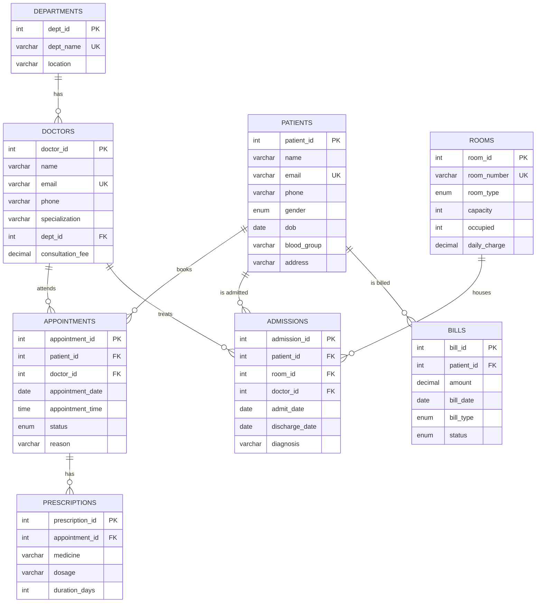

# MediCore Hospital Management System (DBMS Project)

A full-stack Hospital Management System where **the database is the star**. Every feature visibly uses MySQL: joins, constraints, triggers, stored procedures, views, and indexes.

**Live deployment:** [hospital-management-zeta-ruby.vercel.app](https://hospital-management-zeta-ruby.vercel.app)

> **Note:** the deployed frontend needs a cloud MySQL database to show data. The project is designed to run fully on a local MySQL server (see [Installation](#installation)), which is the recommended way to view and demo it.

---

## Table of Contents

1. [Features](#features)
2. [Tech Stack](#tech-stack)
3. [Architecture](#architecture)
4. [ER Diagram](#er-diagram)
5. [Installation](#installation)
6. [Testing](#testing)
7. [Project Structure](#project-structure)

---

## Features

**Application**
- **Dashboard:** live KPIs (patients, doctors, today's appointments, current inpatients, room occupancy %, pending dues), appointments-per-doctor bar chart, room occupancy donut chart, recent activity.
- **Patients:** search, sort, paginate, add, edit, delete, and a detail page with appointments, admissions, prescriptions, and bills.
- **Doctors and Departments:** CRUD with doctors-per-department counts.
- **Rooms:** capacity cards with live availability bars (General, Private, ICU).
- **Appointments:** booking through a stored procedure, status changes (Scheduled, Completed, Cancelled), filters by date, doctor, and status.
- **Admissions:** admit and discharge through stored procedures, with the active list read from a SQL view.
- **Prescriptions:** add medicines to appointments.
- **Bills:** create, filter by status and type, mark as Paid, pending total per patient.
- **DB Insights and Demo Mode:** saved analytical reports with the SQL shown beside each result, plus a guided demo of triggers and procedures.
- **Theme:** light and dark mode with a green-to-black/white colour scheme. The choice is saved.

**Database**
- 8 normalized tables with primary keys, foreign keys, `UNIQUE`, `NOT NULL`, `CHECK`, and `ENUM` constraints.
- 1 view: `current_admissions`.
- 3 stored procedures: `book_appointment`, `admit_patient`, `discharge_patient`.
- 3 triggers: `before_admission` (blocks full rooms), `after_admission` and `after_discharge` (keep `rooms.occupied` correct).
- 2 indexes: `idx_patient_name`, `idx_appointment_date`.
- A unique slot constraint that prevents double-booking a doctor at the same date and time.

---

## Tech Stack

| Layer | Technology |
|-------|-----------|
| Frontend | Next.js (App Router), React, TypeScript, Tailwind CSS |
| UI libraries | Recharts (charts), lucide-react (icons), sonner (toasts), next-themes (dark/light mode) |
| Backend | Next.js route handlers (REST-style API) |
| Validation | Zod |
| Database driver | mysql2 (promise API, connection pool) |
| Database | MySQL 8.0 |
| Tools | MySQL Workbench, VS Code, Git and GitHub, Vercel (frontend hosting) |

---

## Architecture

```
Next.js Frontend (forms, tables, dashboard)
        |  fetch() / JSON
        v
Next.js Backend API (Zod validation + parameterized SQL)
        |  mysql2 connection pool
        v
MySQL 8.0 (hospital_db)
  tables | view | stored procedures | triggers | indexes
```

All SQL runs only inside `app/api/*` route handlers. The business rules (room capacity, slot uniqueness) are enforced by the database itself, not by JavaScript.

---

## ER Diagram



**Relationships**

| Parent table | Child table | Type | Foreign key |
|--------------|-------------|------|-------------|
| departments | doctors | One to many | `doctors.dept_id` |
| patients | appointments | One to many | `appointments.patient_id` |
| doctors | appointments | One to many | `appointments.doctor_id` |
| appointments | prescriptions | One to many | `prescriptions.appointment_id` |
| patients | admissions | One to many | `admissions.patient_id` |
| rooms | admissions | One to many | `admissions.room_id` |
| doctors | admissions | One to many | `admissions.doctor_id` |
| patients | bills | One to many | `bills.patient_id` |

Patients and doctors have a many-to-many relationship through `appointments`.

---

## Installation

### Prerequisites

- **Node.js** v18.18 or higher (v20+ recommended) and **npm**
- **MySQL Server 8.0+** and **MySQL Workbench** (or the `mysql` command-line client)
- **Git**

### 1. Clone the repository

```bash
git clone https://github.com/dakshnarwaria/Hospital-Management.git
cd Hospital-Management
```

### 2. Set up MySQL

Make sure the MySQL server is running and you know your root password.

**Option A: MySQL Workbench**
1. Open a connection to your local server (for example `root@localhost:3306`).
2. Go to **File > Open SQL Script** and choose `db/schema.sql`.
3. Click the lightning bolt (**Execute**) to run the whole script.

**Option B: Command line**
```bash
mysql -u root -p < db/schema.sql
```

The script drops and recreates `hospital_db`, then creates the tables, view, procedures, triggers, indexes, and sample data. Check that it worked:

```sql
USE hospital_db;
SHOW TABLES;
SELECT * FROM current_admissions;
```

> The script starts with `DROP DATABASE IF EXISTS hospital_db;`, so running it again resets all data to the sample data.

### 3. Create the `.env.local` file

The app reads its database credentials from `.env.local` in the project root (the same folder as `package.json`). This file is private and is never pushed to GitHub, so each person creates their own.

Copy the template (do not rename it):

```bash
# Windows (Command Prompt)
copy .env.example .env.local

# macOS / Linux / Git Bash
cp .env.example .env.local
```

Open `.env.local` and enter your own MySQL password:

```env
DB_HOST=localhost
DB_USER=root
DB_PASSWORD=your_mysql_password
DB_NAME=hospital_db
```

> **Security:** never commit `.env.local` or share your real password. `.gitignore` already excludes `.env*` files, with an exception for `.env.example`.

### 4. Install dependencies and run

```bash
npm install
npm run dev
```

Open **http://localhost:3000** in your browser. If you edit `.env.local` while the server is running, stop it (Ctrl+C) and run `npm run dev` again.

### Troubleshooting

| Problem | Likely cause and fix |
|---------|---------------------|
| `Access denied for user 'root'` | Wrong `DB_PASSWORD` in `.env.local`. Fix it and restart `npm run dev`. |
| `Unknown database 'hospital_db'` | The schema was not loaded. Run `db/schema.sql` again. |
| `ECONNREFUSED` | The MySQL service is not running. Start it. |
| Pages load but show no data | `.env.local` is missing or the schema was not imported. Check `/api/health`. |
| Works locally but not on Vercel | Vercel cannot reach `localhost`. A cloud MySQL and Vercel environment variables are needed. |

---

## Testing

### 1. Build and lint

```bash
npm run build     # type-checks and builds the app
npm run lint      # ESLint validation
```

### 2. Connection check

Open **http://localhost:3000/api/health**. A successful response such as `[{"healthy":1}]` confirms that Next.js can reach MySQL.

### 3. Database tests (run in MySQL Workbench)

These use the sample data from a fresh `schema.sql` run.

| # | Test | Command | Expected result |
|---|------|---------|-----------------|
| 1 | Trigger blocks a full room | `CALL admit_patient(4, 1, 3, 'Observation');` | Error: `Room is full` (room G101 has capacity 2 and 2 patients) |
| 2 | Trigger frees a bed on discharge | `CALL discharge_patient(1);` then `SELECT room_number, occupied FROM rooms;` | G101 `occupied` drops from 2 to 1 |
| 3 | Admission trigger adds a bed | `CALL admit_patient(4, 1, 3, 'Observation');` after test 2 | Succeeds, G101 `occupied` returns to 2 |
| 4 | Double booking is rejected | `CALL book_appointment(1, 1, CURDATE(), '10:00:00', 'Test');` | Duplicate entry error on the doctor, date, and time slot |
| 5 | View shows current inpatients | `SELECT * FROM current_admissions;` | Only patients with no discharge date |
| 6 | CHECK constraint | `UPDATE doctors SET consultation_fee = -1 WHERE doctor_id = 1;` | Constraint violation error |
| 7 | UNIQUE constraint | Insert a patient with an existing email | Duplicate entry error |
| 8 | Foreign key protection | `DELETE FROM departments WHERE dept_id = 1;` | Foreign key error (doctors still reference it) |
| 9 | Aggregate report | `SELECT p.name, SUM(b.amount) AS pending FROM bills b JOIN patients p ON b.patient_id = p.patient_id WHERE b.status = 'Pending' GROUP BY p.name;` | One row per patient with unpaid bills |

### 4. Application tests (run in the browser)

| Page | What to do | Expected result |
|------|-----------|-----------------|
| Dashboard `/` | Open the page | KPI cards, bar chart, and donut chart show data |
| Patients `/patients` | Add, edit, search, then delete a patient with no history | Table updates, toast confirms each action |
| Patients `/patients` | Delete a patient who has appointments | Friendly foreign key error message |
| Appointments | Book the same doctor, date, and time twice | The second booking shows an error toast |
| Admissions | Admit patients into a full room | "Room is full" error toast |
| Admissions | Discharge a patient | The room occupancy bar goes down immediately |
| Bills | Mark a pending bill as Paid | Status changes and the pending total updates |
| Theme | Click the dark/light toggle and refresh | The chosen theme stays |
| `/insights` | Click through the Demo Mode steps 1 to 4 | Each step shows the matching SQL result or error |

---

## Project Structure

```
Hospital-Management/
├── .env.example          # Environment variable template (safe to commit)
├── db/
│   └── schema.sql        # Tables, view, procedures, triggers, indexes, sample data
├── lib/
│   ├── db.ts             # mysql2 connection pool
│   ├── errors.ts         # MySQL error to JSON message mapping
│   └── validators.ts     # Zod schemas
├── components/           # Shared UI (sidebar, navbar, data table, modal, theme toggle, cards)
├── app/
│   ├── globals.css       # Theme colours and gradients
│   ├── layout.tsx        # Root layout with theme provider and toaster
│   ├── (dashboard)/      # Pages: dashboard, patients, doctors, rooms, appointments,
│   │                     #        admissions, prescriptions, bills, insights
│   └── api/              # Route handlers: health, stats, patients, doctors, departments,
│                         #   rooms, appointments, admissions, prescriptions, bills,
│                         #   insights, demo
└── package.json
```

---
